# FinanceTrack - Personal Finance Management Application

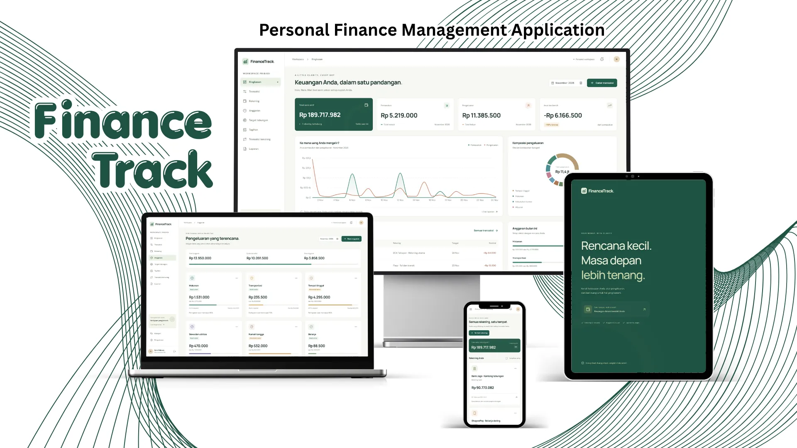


## Project Overview

FinanceTrack is a full-stack personal finance management web application built to consolidate multi-account cash flow tracking, monthly budgeting, recurring transaction automation, bill reminders, savings goal progress, and financial reporting in one self-contained system. It addresses common issues in manual spreadsheet tracking—such as drifted balances, duplicate submissions during network retries, and lack of transaction auditability—by enforcing an atomic SQLite ledger with minor-unit integer arithmetic, idempotency keys, and strict per-user data isolation.

## Key Features

- **Multi-Account Ledger & Transfers**: Track cash, bank, e-wallet, and custom accounts with dynamically aggregated running balances, opening balance dates, internal transfers, edit history audits, and non-destructive transaction voiding.
- **Monthly Category Budgets & Threshold Alerts**: Define per-category monthly spending limits with customizable warning thresholds (`1%–99%`), real-time utilization indicators (`safe`, `warning`, `exceeded`), and deduplicated in-app notifications.
- **Automated Recurring Scheduler**: Configure daily, weekly, monthly, or yearly income and expense schedules with catch-up execution at backend startup and 60-second intervals, timezone awareness, pause/end controls, and failure alerts.
- **Bills & Payment Linking**: Monitor upcoming, due-today, and overdue bills with configurable reminder lead days (`0–30` days), pay bills by creating a new expense or linking an existing transaction, and automatically generate the next recurring bill period.
- **Savings Goals & Progress Tracking**: Set savings targets with optional linked accounts and target dates, log progress-only contributions without altering account balances, and void or adjust contributions as needed.
- **Interactive Dashboard & Analytics**: View real-time total active balance, monthly income/expense/net cash flow summaries, daily cash flow area charts, category expense donut breakdowns, 6-month trend comparisons, and recent activity.
- **Filterable Reports with CSV & PDF Export**: Filter transactions by date range, account, category, transaction type, description search, and sort order, then export filtered datasets as formula-safe UTF-8 CSV or multi-page A4 PDF reports with embedded Noto Sans typography.
- **Security-First Session & Profile Controls**: Protect user data with `bcryptjs` password hashing, `HttpOnly` `SameSite=Strict` session cookies, `X-CSRF-Token` verification, origin guards, rate-limited auth endpoints, password reset emails, and cascading account deletion.

## Tech Stack

| Category | Technology | Purpose |
| :--- | :--- | :--- |
| Frontend UI | React 19 | Component-based single-page user interface with lazy-loaded route modules |
| Client Routing | React Router 7 | Declarative SPA routing with authenticated route guards and auth redirects |
| Data Visualization | Recharts 3 | Interactive daily cash flow area charts and category expense donut charts |
| Icons | Lucide React | Consistent vector iconography across navigation, cards, and forms |
| Frontend Build Tool | Vite 7 | Fast development server with `/api` proxy and optimized production bundling |
| Backend Runtime | Node.js (>=24) | ESM runtime with built-in `node:sqlite`, `node:test`, and native `.env` loading |
| Backend Framework | Express 5 | Monolithic REST API server, middleware pipeline, and static SPA fallback |
| Database | SQLite (`node:sqlite`) | WAL-enabled persistent ACID database storing relational tables and validated JSON records |
| Schema Validation | Zod 4 | Strict request body, query filter, monetary precision, and timezone validation |
| Authentication & Security | `bcryptjs`, `helmet`, `cookie-parser`, `express-rate-limit` | Password hashing, security headers, cookie parsing, and auth brute-force rate limiting |
| Reporting & Email | `pdfkit`, `nodemailer` | Server-side A4 PDF report generation and SMTP / local `.eml` password recovery |
| Reverse Proxy & Containers | Nginx, Docker Compose, Mailpit | Production SPA serving, `/api` proxying, container orchestration, and local SMTP testing |
| Testing | `node:test`, `supertest` | Automated backend integration test suite covering 18 end-to-end scenarios |

## Application Architecture

FinanceTrack follows a layered full-stack architecture where a lazy-loaded React SPA communicates exclusively through same-origin `/api` requests, proxied by Vite in development or Nginx in Docker Compose. The Express 5 backend enforces security middleware (`helmet`, `originGuard`, `express-rate-limit`, session + CSRF `authenticate`, and `idempotent` request deduplication) before delegating business operations to the `ledger`, `reports`, and `scheduler` services backed by WAL-mode SQLite transactions (`BEGIN IMMEDIATE`).

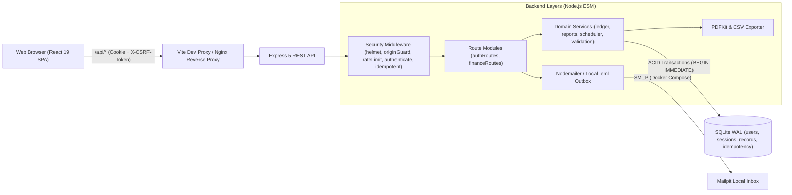

## Screenshots / Preview

### 1. Authentication & Login Screen
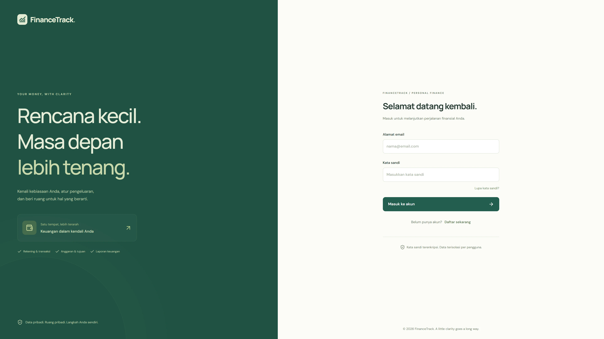
The split-screen authentication page pairs a branded green summary panel on the left with a clean sign-in form on the right, supporting password recovery links and instant switching to account registration without storing session tokens in `localStorage`.

### 2. Financial Overview Dashboard
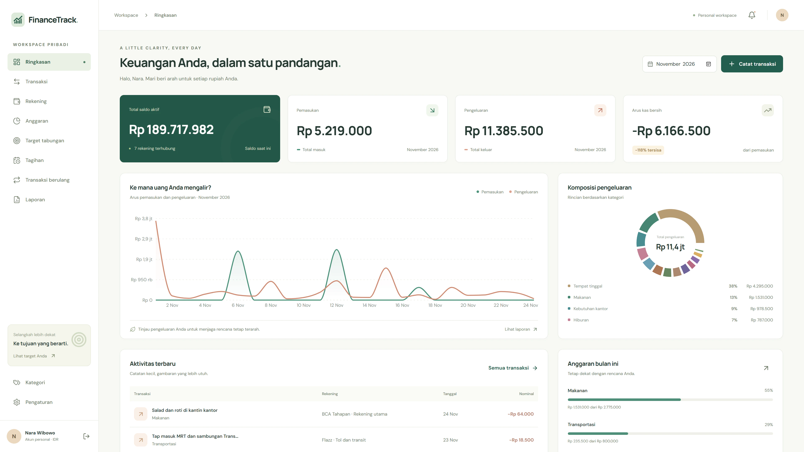
The main dashboard aggregates live financial metrics across four KPI cards (Total Active Balance, Income, Expense, and Net Cash Flow), accompanied by a daily cash flow trend chart, a category expense donut breakdown, recent transactions, and monthly budget progress bars.

### 3. Transactions Ledger & Filtering
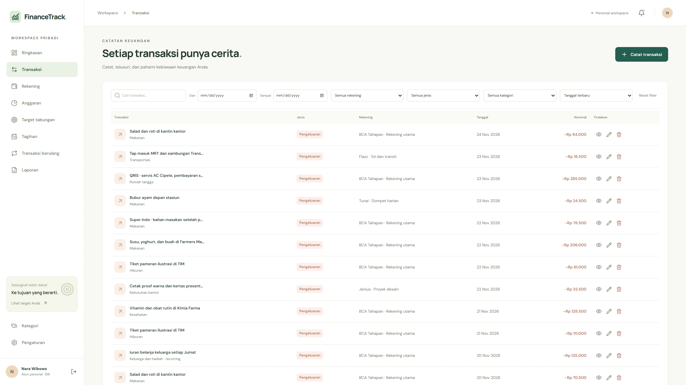
The transactions workspace provides full-text description search, date range pickers, account/type/category dropdowns, and multi-column sorting over active ledger records, with row actions to inspect audit history, edit entries, or void transactions.

### 4. Accounts & Balance Management
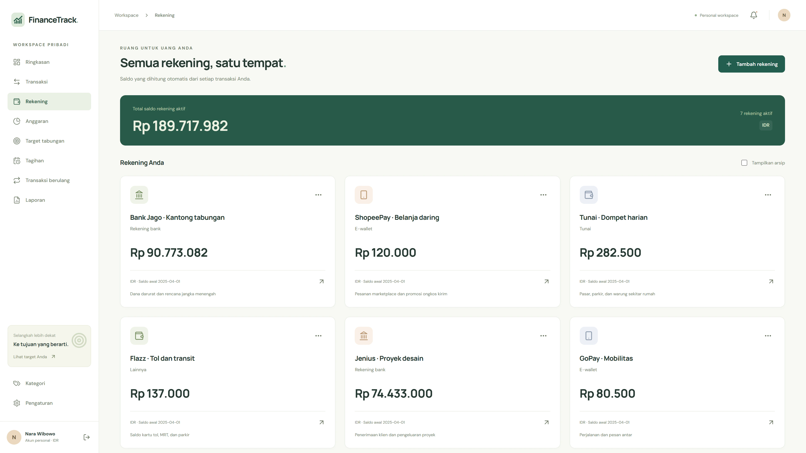
The accounts view displays the combined active balance across all linked accounts and renders individual cards for bank, e-wallet, cash, and custom accounts with real-time computed balances, opening balance dates, and archive controls.

### 5. Monthly Budgets & Threshold Tracking
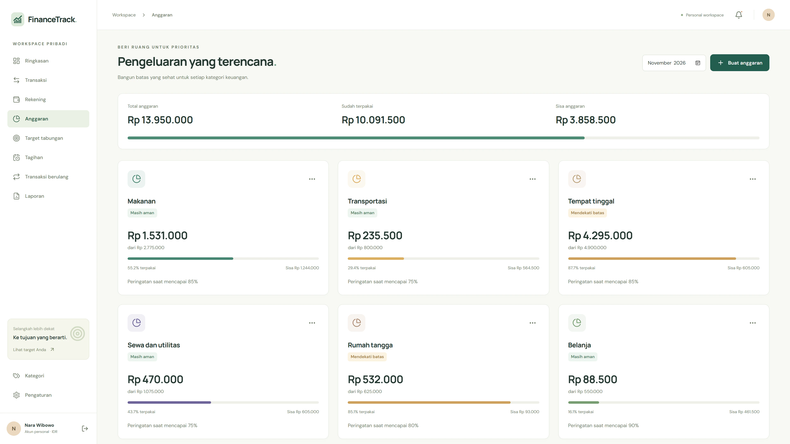
The budgets page tracks monthly spending limits per expense category, showing aggregate budget allocation versus usage at the top and individual cards displaying percentage progress bars, remaining amounts, and status badges (`safe`, `warning`, `exceeded`).

### 6. Savings Goals & Progress Tracking
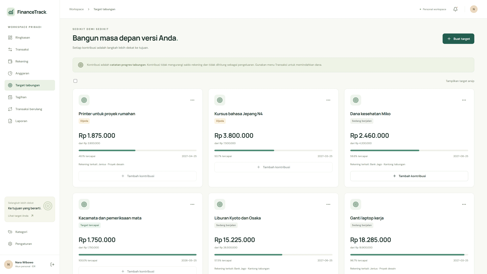
The savings goals screen highlights progress-only contribution tracking (without mutating account balances), presenting each goal's completion percentage, target date, optional linked account, status indicator, and a direct button to record new contributions.

### 7. Bills & Due Date Reminders
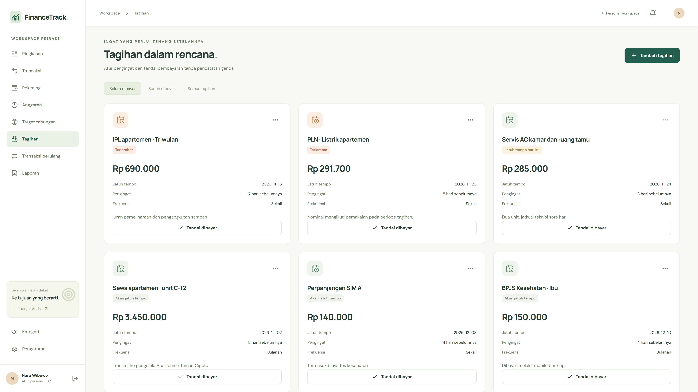
The bills manager organizes unpaid, paid, and all bills into filterable tabs, highlighting overdue, due-today, and upcoming bills alongside reminder lead days, recurrence frequency, and a one-click payment action that links or creates an expense transaction.

### 8. Recurring Transactions Scheduler
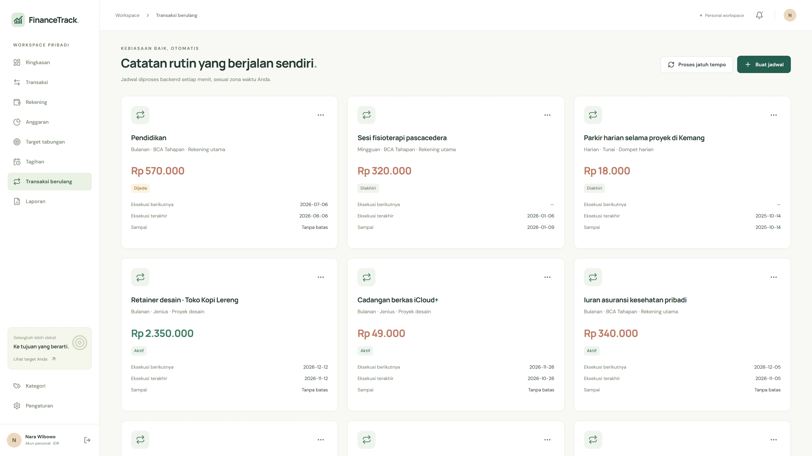
The recurring transactions view displays automated income and expense schedules across active, paused, and ended states, showing recurrence cadence, next and last execution timestamps, and a manual trigger to process due schedules immediately.

### 9. Financial Reports & Export Center
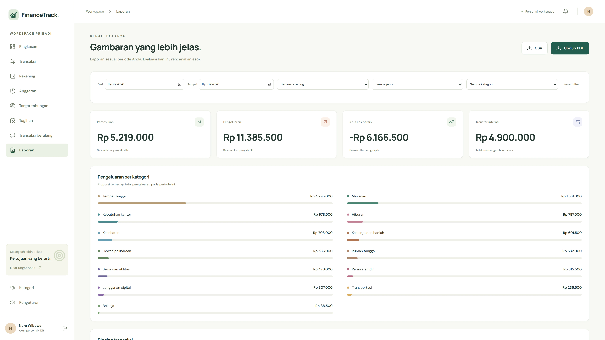
The reports center evaluates filtered income, expense, net cash flow, and internal transfer totals alongside horizontal category expense proportion bars, offering one-click downloads for formula-safe CSV files and formatted A4 PDF reports.

### 10. Income & Expense Category Management
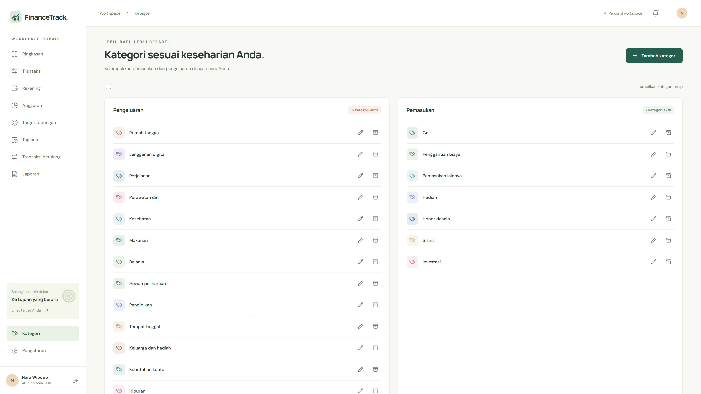
The category management page separates expense and income categories into dual columns with color-coded labels, inline edit and soft-archive controls, and an optional toggle to inspect archived categories.

### 11. Profile, Preferences & Account Security
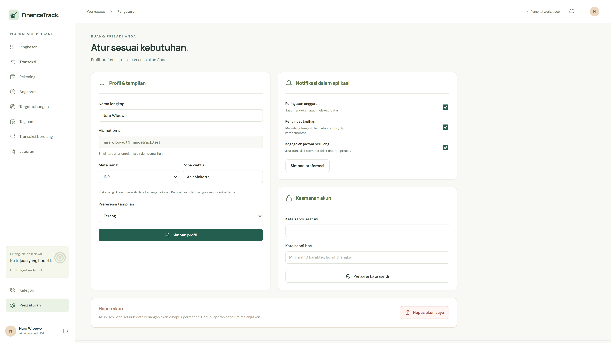
The settings workspace allows users to manage their display name, timezone, theme preference, and locked base currency, toggle in-app notification categories, update passwords (revoking other active sessions), or permanently delete their account.

### 12. In-App Notification Center
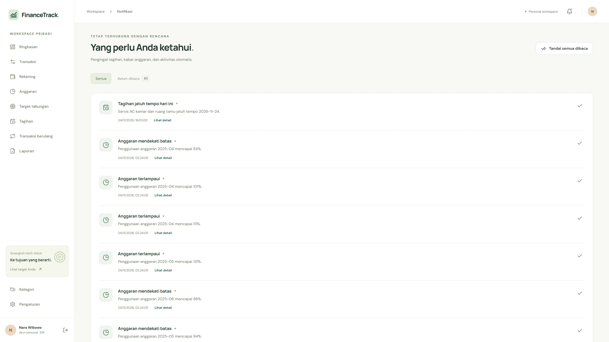
The notification center aggregates deduplicated alerts for budget warnings, exceeded limits, due or overdue bills, and recurring execution failures, providing unread filtering, deep links to affected modules, and single or bulk read actions.

## Prerequisites

- **Node.js**: `>=24.0.0` (required for built-in `node:sqlite` and `--env-file-if-exists` support)
- **npm**: Included with Node.js for workspace dependency management
- **Docker & Docker Compose** *(optional)*: Required only if running the containerized Nginx, backend, and Mailpit stack

## Installation & Setup

1. Clone the repository and enter the project directory:
   ```bash
   git clone https://github.com/weztcy/FinanceTrack-Personal-Finance-Management-Application.git
   cd "FinanceTrack - Personal Finance Management Application"
   ```

2. Install all workspace dependencies (`root`, `frontend`, and `backend`):
   ```bash
   npm install
   ```

3. Create the backend environment file from the example template:
   ```bash
   cp backend/.env.example backend/.env
   ```

4. Optionally seed sample development data into the local SQLite database:
   ```bash
   npm run seed
   ```

## Usage

Run both the Express API (`127.0.0.1:4000`) and Vite development server (`127.0.0.1:5173`) concurrently, or launch the full production container stack with Docker Compose.

1. **Start the local development environment** (API + Frontend with hot reload):
   ```bash
   npm run dev
   ```
   Access the application at `http://localhost:5173`.

2. **Build and serve in production mode locally**:
   ```bash
   npm run build
   npm start
   ```

3. **Run the full containerized stack** (Nginx frontend on port `8080`, Node.js backend, and Mailpit UI on port `8025`):
   ```bash
   docker compose up --build -d
   ```

4. **Create a consistent SQLite backup** using the built-in backup script:
   ```bash
   npm run backup
   ```

## Environment Variables

Configuration is managed through `.env` for Docker Compose or `backend/.env` for local backend execution. All variables have development defaults in `backend/src/config.js` and `compose.yaml`.

| Variable | Description | Example |
| :--- | :--- | :--- |
| `PORT` | Port bound by the Express backend server | `4000` |
| `HOST` | Network interface bound by the backend server | `127.0.0.1` |
| `APP_ORIGIN` | Allowed request origin verified by `originGuard` | `http://localhost:5173` |
| `DATABASE_PATH` | File path for the SQLite database file | `./data/financetrack.sqlite` |
| `NODE_ENV` | Runtime mode (`development` or `production`) | `development` |
| `COOKIE_SECURE` | Enforces `Secure` flag on `ft_session` cookie over HTTPS | `false` |
| `TRUST_PROXY` | Set to `1` when running behind Nginx reverse proxy | `1` |
| `SCHEDULER_INTERVAL_MS` | Interval in milliseconds for recurring job polling | `60000` |
| `SMTP_HOST` | SMTP server hostname for password reset emails | `mailpit` |
| `SMTP_PORT` | SMTP server port | `1025` |
| `SMTP_FROM` | Sender address used in password reset emails | `FinanceTrack <noreply@financetrack.local>` |
| `SMTP_SECURE` | Enable TLS for SMTP transport (`true` or `false`) | `false` |
| `SMTP_USER` | Optional SMTP authentication username | `""` |
| `SMTP_PASSWORD` | Optional SMTP authentication password | `""` |

```env
PORT=4000
APP_ORIGIN=http://localhost:5173
DATABASE_PATH=./data/financetrack.sqlite
NODE_ENV=development
COOKIE_SECURE=false
SMTP_HOST=localhost
SMTP_PORT=1025
SMTP_FROM=FinanceTrack <noreply@financetrack.local>
SCHEDULER_INTERVAL_MS=60000
```

## API Documentation

FinanceTrack exposes a monolithic JSON REST API under the `/api` prefix, plus binary CSV and PDF export endpoints. All mutating requests require `Content-Type: application/json`, an `Origin` matching `APP_ORIGIN`, a valid `X-CSRF-Token` header on authenticated routes, and an `Idempotency-Key` header (`8–100` characters) on resource creation endpoints. See [API.md](API.md) for full request/response schemas.

| Method | Endpoint | Description | Authentication |
| :--- | :--- | :--- | :--- |
| `GET` | `/api/health` | Check API readiness and SQLite connectivity | Public |
| `POST` | `/api/auth/register` | Register account, seed 13 default categories, issue session | Public (Rate-limited) |
| `POST` | `/api/auth/login` | Authenticate user and set `ft_session` cookie + CSRF token | Public (Rate-limited) |
| `POST` | `/api/auth/forgot-password` | Generate 30-minute single-use recovery token via SMTP/outbox | Public (Rate-limited) |
| `POST` | `/api/auth/reset-password` | Reset password and revoke all active user sessions | Public (Rate-limited) |
| `POST` | `/api/auth/logout` | Terminate current session and clear cookie | Session + CSRF |
| `POST` | `/api/auth/change-password` | Update password and revoke other device sessions | Session + CSRF + Rate-limited |
| `GET` / `PATCH` / `DELETE` | `/api/profile` | Read profile/CSRF token, update preferences, or cascade-delete account | Session (+ CSRF on write) |
| `GET` / `POST` / `PATCH` | `/api/accounts` | List accounts with computed balance, create, update, or archive | Session (+ CSRF + Idempotency) |
| `GET` / `POST` / `PATCH` / `DELETE` | `/api/categories` | Manage income and expense categories with soft archiving | Session (+ CSRF + Idempotency) |
| `GET` / `POST` / `PATCH` | `/api/transactions`, `/api/transfers` | Filter/paginate active transactions, record income/expense/transfer, or void | Session (+ CSRF + Idempotency) |
| `GET` / `POST` / `PATCH` / `DELETE` | `/api/budgets` | Manage monthly category budgets and spending status | Session (+ CSRF + Idempotency) |
| `GET` / `POST` / `PATCH` | `/api/recurring`, `/api/recurring/process` | Manage recurring schedules or trigger due execution | Session (+ CSRF + Idempotency) |
| `GET` / `POST` / `PATCH` | `/api/goals`, `/api/goals/:id/contributions` | Manage savings goals and progress-only contributions | Session (+ CSRF + Idempotency) |
| `GET` / `POST` / `PATCH` | `/api/bills`, `/api/bills/:id/pay` | Manage bills and pay idempotently via new or existing expense | Session (+ CSRF + Idempotency) |
| `GET` / `PATCH` / `POST` | `/api/notifications` | Evaluate reminders and mark individual or all alerts as read | Session (+ CSRF on write) |
| `GET` | `/api/dashboard/summary`, `/api/dashboard/trends` | Fetch aggregated KPIs, 6-month trends, budgets, goals, and bills | Session |
| `GET` | `/api/reports/summary`, `/api/reports/export.csv`, `/api/reports/export.pdf` | Fetch filtered aggregates or download CSV/PDF reports | Session |

```bash
# Example: Create an expense transaction with session cookie, CSRF token, and Idempotency-Key
curl -X POST http://127.0.0.1:4000/api/transactions \
  -b cookies.txt \
  -H "Content-Type: application/json" \
  -H "X-CSRF-Token: <csrf-token>" \
  -H "Idempotency-Key: tx-create-2026-001" \
  -d '{"type":"expense","amount":45000,"date":"2026-11-10","accountId":"<account-uuid>","categoryId":"<category-uuid>","description":"Lunch"}'
```

## Database Configuration

FinanceTrack uses Node.js built-in `node:sqlite` (`DatabaseSync`) with `PRAGMA foreign_keys=ON`, `PRAGMA journal_mode=WAL`, and `PRAGMA busy_timeout=5000`. Financial entities are stored as validated JSON documents inside the `records` table with expression indexes on date, account, category, budget period uniqueness, notification deduplication keys, recurring occurrence keys, and bill payment links.

1. **Automatic schema initialization**: Opening the server automatically creates `users`, `sessions`, `password_resets`, `records`, `idempotency`, and `schema_migrations` tables if they do not exist.
2. **Seed sample data (optional)**: Populate development records with the CLI seed script:
   ```bash
   npm run seed
   ```
3. **Create a hot backup**: Run the SQLite backup utility to write a verified snapshot:
   ```bash
   npm run backup
   ```

## Authentication & Authorization

FinanceTrack implements a personal single-tier user authorization model where every database query scopes records by the authenticated `req.user.id` derived from the verified session.

- **Password Security**: Passwords require 10–72 characters (max 72 UTF-8 bytes) with both letters and digits, hashed using `bcryptjs` with cost factor 12 and verified via constant-time comparison.
- **Session Cookies & CSRF**: Successful login or registration stores a SHA-256 token hash in `sessions` (7-day expiry), sets an `HttpOnly`, `SameSite=Strict` `ft_session` cookie, and pairs it with a session-bound `X-CSRF-Token` required on every mutating endpoint.
- **Origin & Rate Limiting**: `originGuard` restricts mutating requests to `APP_ORIGIN` and `application/json` payloads (`64kb` max), while `express-rate-limit` limits `/api/auth/*` and account deletion endpoints to 20 requests per 15 minutes per IP.
- **Session Revocation**: Password resets revoke all user sessions, password changes revoke all other device sessions, and account deletion cascades across all tables via foreign keys.

## Testing

Backend integration tests run against an in-memory SQLite instance using Node's native test runner (`node:test`) and `supertest`, while `smoke.js` verifies the full Docker Compose stack over real HTTP requests.

- **Integration Suite (`backend/tests/integration.test.js`)**: Covers 18 scenarios including auth/CSRF/origin rejection, decimal/date validation, ledger voiding and transfers, idempotency conflict detection (`409`), cross-user isolation, budget thresholds, recurring catch-up and failure handling, savings contributions, bill payment linking, backup/restore integrity, password reset, account deletion, and rate limiting (`429`).
- **Docker Smoke Test (`backend/scripts/smoke.js`)**: Exercises Nginx SPA routing, registration, balance arithmetic, filtered reports, CSV/PDF binary output, Mailpit password recovery delivery, and cleanup via `DELETE /api/profile`.

```bash
# Run the 18-scenario backend integration test suite
npm test

# Run the live HTTP smoke test against Docker Compose (port 8080)
npm run smoke -w backend
```

## Build & Deployment

The repository includes a multi-stage `Dockerfile` and `compose.yaml` defining three coordinated services (`frontend`, `backend`, and `mailpit`) with persistent storage on the `finance-data` volume.

1. **Build the frontend static bundle manually**:
   ```bash
   npm run build
   ```
2. **Validate the Compose configuration**:
   ```bash
   docker compose config --quiet
   ```
3. **Build and launch the production containers**:
   ```bash
   docker compose up --build -d
   ```
   Nginx listens on `127.0.0.1:8080`, serves immutable hashed assets from `frontend/dist`, enforces CSP and security headers, and proxies `/api/` requests to the `backend` container after its `/api/health` check passes.

## Contributing

Contributions are welcome for bug fixes, test coverage improvements, and documentation updates. Please follow this standard workflow when submitting changes:

1. Fork the repository.
2. Create a feature or fix branch (`git checkout -b feat/your-change`).
3. Make and test your changes (`npm test` and `npm run build`).
4. Commit and push your branch to your fork.
5. Open a pull request with a clear explanation of the changes and verification results.

## License

This project is licensed under the MIT License.
See the [LICENSE](LICENSE) file for details.

## Author & Contact

**Yohanes Dimas Pratama**

- GitHub: [github.com/weztcy](https://github.com/weztcy)
- Portfolio: [yohanesdimas.com](https://yohanesdimas.com)
- LinkedIn: [linkedin.com/in/yohanes-dimas](https://www.linkedin.com/in/yohanes-dimas)
